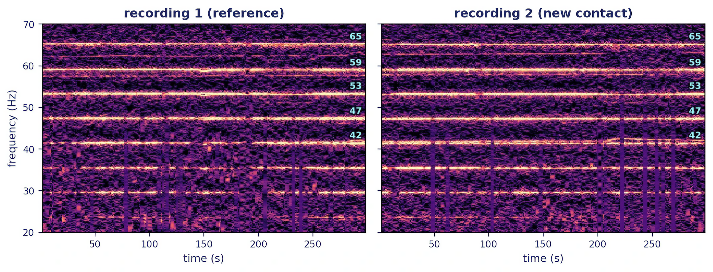
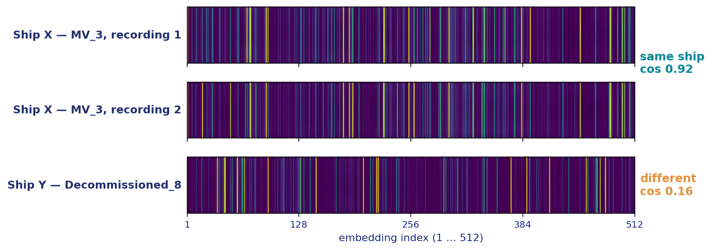
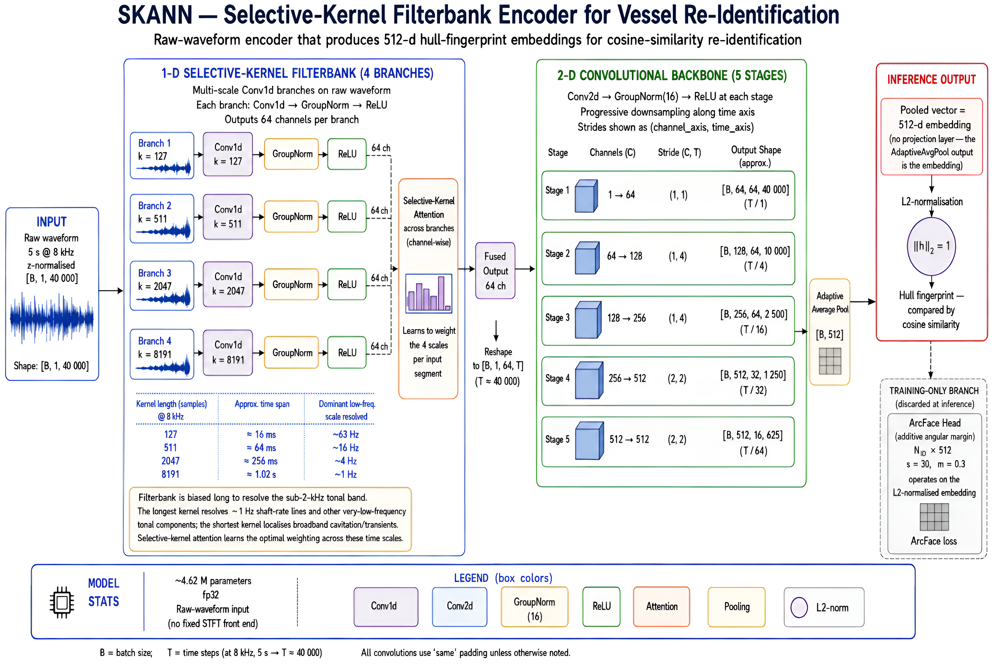
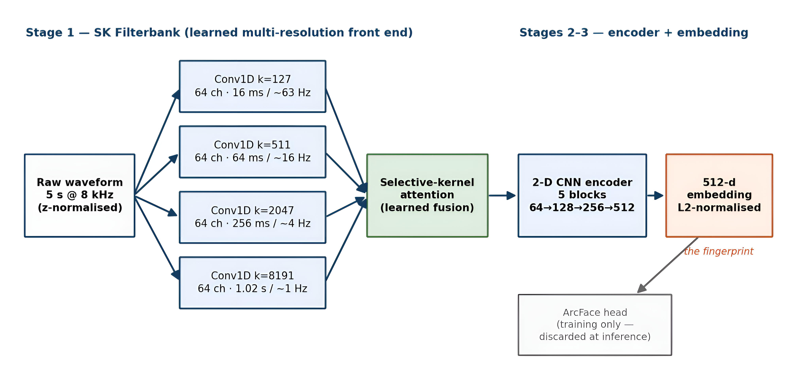

# Usability of the Re-ID Application

## SKANN Vessel Re-Identification — what it does, what it measures, and what it changes

*Oravont Systems LLP for Altair Infrasec Pvt Ltd · disc5-reid v1.1 · Model `disc5_arcface_8k_ft2_ep003.pth` (frozen) · August 2026*

This note answers one question: what does the Re-ID application do for the end user that is not being done today? It describes the operational purpose (§1), the two independent methods the application runs (§2), why the new method is built the way it is (§3), what changes for the operator, the analyst and the unit (§4), and a brief account of the technology (§5). Companion documents: the *Re-ID User Manual* covers operation step by step, and *DISC5 Re-ID System Flow* covers what happens inside, file by file.

---

## 1. Purpose

Re-ID answers one operational question: **"Which known vessel does this recording sound like?"** An operator loads a passive-sonar recording (a WAV file), and the application returns a ranked list of candidate vessels from a gallery of previously enrolled recordings, each with a similarity score.

Today that question is answered by an analyst reading LOFAR displays: locating narrowband tonal lines, comparing their frequencies against remembered or recorded line sets, and judging a match. That skill is real and remains valuable — but it is slow, depends on the individual analyst, and degrades under exactly the conditions of operational interest: sea-state noise and closing/opening targets whose tonals are Doppler-shifted.

Re-ID automates the comparison step. It does not replace the analyst's judgement about what to do with a match; it replaces the minutes-to-hours of manual line comparison with a ranked shortlist produced in seconds, consistently, from any operator.

## 2. The two methods inside the application

Re-ID deliberately runs **two independent methods side by side** on every query, because they fail differently and agreement between them is itself information.

**LOFAR-tonal (the familiar method, automated).** The application extracts up to 20 narrowband tonal lines from the recording using a TPSW whitener — the same physics the analyst reads by eye — and scores candidates by how well line frequencies match. This column behaves the way an analyst expects a line-matching method to behave, including its weaknesses.

*Figure 1: Two passages of the same vessel, tonal lines labelled — what the tonal method compares.*

**SKANN (the new method).** A deep neural network reads the raw waveform and produces a 512-dimensional acoustic **fingerprint** of the vessel — a compact numerical signature capturing the full character of the radiated sound (harmonic structure, broadband texture, modulation), not just line positions. Two recordings are compared by the cosine similarity of their fingerprints.

*Figure 2: Waveform → network → 512-dimensional fingerprint — the enrol/query concept.*

The two columns are never numerically fused. When both methods rank the same vessel in the top 3, the app tags the agreement — that convergence of two unrelated mechanisms is the strongest single indicator the application offers.

## 3. Why SKANN — what it is designed to withstand

A ±4% change in a vessel's speed shifts every tonal line by ±4% of its frequency — enough to break frequency matching — and sea-state noise buries the weaker lines. The SKANN fingerprint does not rest on matching individual line frequencies: it captures the full character of the radiated sound (§2), and it is trained with augmentation that perturbs recording conditions (§5), so that recordings of the same hull stay close together. **A closing or opening contact in weather is the realistic case.**

## 4. What this means operationally

For the **operator**, Re-ID turns a specialist comparison task into a load-file-read-list task: a query takes seconds, needs no line-reading skill, and produces the same answer regardless of who runs it. For the **analyst**, it is a force multiplier and a second opinion — the shortlist arrives pre-ranked with both methods' views and the full evidence (scores, tonal lines, spectrogram) one click away, leaving the analyst's time for the judgement calls the machine cannot make: whether a 0.68 against a three-passage gallery entry in heavy weather is a call to escalate. For the **unit**, the gallery itself becomes an asset: every enrolled passage compounds, building an acoustic reference library that survives postings and shift changes.

The model is **frozen** — it never retrains in the field, so its behaviour is fixed, testable and certifiable. What grows is the **gallery**. And because the model has never been trained on the end user's own recording chain, performance on the end user's data is expected to improve further if the model is ever fine-tuned on it — an option, not a requirement, and gated by a formal evaluation.

## 5. A brief note on the technology (SKANN)

SKANN is a raw-waveform convolutional neural network (~4.6 M parameters) purpose-built for ship-radiated noise — there is no fixed spectrogram front end; the network learns its own time–frequency analysis. Audio is resampled to 8 kHz mono, cut into 5-second segments and z-normalised, then processed in three stages:

*Figure 3: Model structure — SK filterbank → selective-kernel fusion → 2-D encoder → 512-d fingerprint.*

**SK Filterbank.** Four parallel banks of learned filters run over the raw waveform at kernel lengths of 127 / 511 / 2,047 / 8,191 samples — at 8 kHz, analysis windows from ~16 ms to ~1 second. Short kernels localise broadband transients and cavitation in time; the longest kernels resolve frequency to ~1 Hz, sharp enough for slow shaft-rate lines. A **selective-kernel attention** stage then learns, per segment, how to weight and fuse the four scales — the network decides what matters in each recording rather than having frequency bands hand-assigned.

*Figure 4: The same chain as a labelled schematic — kernel lengths, resolutions, and the training-only ArcFace head.*

**Convolutional encoder.** The fused feature map is treated as a learned time–frequency image and passed through a five-block 2-D convolutional encoder, pooled to a single vector, projected to a **512-dimensional embedding** and normalised to unit length. That normalised vector *is* the fingerprint; a recording's fingerprint is the mean of its segment embeddings, re-normalised. Unit normalisation is what makes cosine similarity the correct comparison.

**Training.** The network was trained with an **ArcFace** angular-margin objective over hundreds of vessel identities drawn from multiple ocean datasets and recording systems, with heavy augmentation — added sea-state noise and speed perturbation among five transforms — so that recordings of the *same* hull cluster tightly on the unit hypersphere while *different* hulls are pushed apart by a margin, regardless of recording conditions. The ArcFace classification head exists **only during training**; at inference it is discarded and only the embedding backbone ships. The fielded model is therefore a fixed function from audio to fingerprint with no vessel list baked in — the vessel list is the gallery, and the gallery is yours.

Full training details — datasets, augmentation design, epoch-set construction, checkpoint lineage and evaluation protocol — are documented separately and are not part of this repository.
